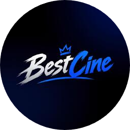

<p align="center">
  
</p>

<h1 align="center">🎬 BestCine (v1.1.11) — Windows, macOS, Linux, Android &amp; iOS</h1>

<p align="center">
  <strong>Aplicativo cliente oficial do BestCine para Computadores (Windows, macOS e Linux) e Celulares / Tablets (Android e iOS).</strong><br/>
  Interface em Português (BR), Player Multimídia Nativo, Suporte a Legendas, Múltiplos Perfis e Atualização Automática.
</p>

<p align="center">
  <a href="https://bestcine.github.io">
    
  </a>
  <a href="https://github.com/BestCine/BestCine/releases/latest">
    
  </a>
  <a href="https://github.com/BestCine/BestCine-TV">
    
  </a>
  <a href="https://dsc.gg/bestcine">
    
  </a>
</p>

> 🌐 **JEITO MAIS FÁCIL DE BAIXAR (TODOS OS APARELHOS EM 1 PÁGINA):** acesse **[https://bestcine.github.io](https://bestcine.github.io)** e clique no botão do seu aparelho!

---

## 🎯 QUAL É O SEU APARELHO? (CLIQUE E BAIXE DIRETO — NÃO PRECISA ABRIR "ASSETS")

> ⚠️ **ATENÇÃO ANTES DE BAIXAR!**
> - **Celular / Tablet Android** usa toque na tela → baixe **AQUI** (APK único universal 32 e 64 bits).
> - **Mi Box / TV Box / Fire TV / Google TV / Samsung / LG** usa controle remoto → baixe o **BestCine TV** (ou use o código **`6617912`** no app **Downloader**)! **NÃO instale o app de celular na TV Box ou o controle remoto não vai navegar!**

| Qual aparelho você vai usar? | Clique para baixar o arquivo certo |
| :--- | :--- |
| 💻 **Windows PC (10 ou 11 — 64-bit)** | 👉 **[⬇️ BAIXAR PARA WINDOWS (.msi)](https://github.com/BestCine/BestCine/releases/download/v1.1.11/BestCine-Windows-x64-1.1.11.msi)** |
| 🍎 **macOS Apple Silicon (M1, M2, M3, M4)** | 👉 **[⬇️ BAIXAR PARA MAC APPLE SILICON (.dmg)](https://github.com/BestCine/BestCine/releases/download/v1.1.11/BestCine-macOS-arm64-1.1.11.dmg)** |
| 🍎 **macOS Intel (Macs anteriores a 2020)** | 👉 **[⬇️ BAIXAR PARA MAC INTEL (.dmg)](https://github.com/BestCine/BestCine/releases/download/v1.1.11/BestCine-macOS-x86_64-1.1.11.dmg)** |
| 🐧 **Linux (x86_64 — Universal)** | 👉 **[⬇️ BAIXAR PARA LINUX (.AppImage)](https://github.com/BestCine/BestCine/releases/download/v1.1.11/BestCine-Linux-x86_64-1.1.11.AppImage)** |
| 📱 **Celular ou Tablet Android (APK único universal — 32 e 64 bits)** | 👉 **[⬇️ BAIXAR PARA CELULAR ANDROID (.apk)](https://github.com/BestCine/BestCine/releases/download/v1.1.11/BestCine-Android-universal-1.1.11.apk)** |
| 🍏 **iOS — iPhone / iPad (SideStore / AltStore Classic / Sideloadly)** | 👉 **[⬇️ BAIXAR PARA iOS (.ipa)](https://github.com/BestCine/BestCine/releases/download/v1.1.11/BestCine-iOS-1.1.11.ipa)** · Fonte: **[altstore.json](https://bestcine.github.io/altstore.json)** |
| 📺 **Mi Box / TV Box / Fire TV Stick / Google TV (TCL, Philips, Sony…)** | 👉 **[⬇️ BAIXAR BESTCINE TV (.apk)](https://github.com/BestCine/BestCine-TV/releases/latest/download/BestCineTV-android-lite-universal.apk)** · App Downloader: **`6617912`** |
| 📺 **Smart TV Samsung (Tizen) ou Smart TV LG (webOS)** | 👉 **[📺 ABRIR PÁGINA DO BESTCINE TV (LG &amp; SAMSUNG)](https://github.com/BestCine/BestCine-TV)** |

> 🔄 **Atualização Automática:** se você já tem o BestCine instalado no Windows ou no Celular Android, basta abrir o app para receber o aviso e atualizar automaticamente!

---

## ✨ Recursos Principais

- 🔐 **Login Google &amp; QR Code:** conecte sua conta em 1 clique e sincronize automaticamente suas preferências e perfis.
- 🎬 **Player Nativo com Picture-in-Picture (PiP):** reprodução acelerada por hardware (`libmpv` / `Media3 ExoPlayer`), suporte a legendas e janela flutuante.
- 📚 **Organização Pessoal:** *Continuar assistindo*, *Favoritos* e *Histórico* sincronizados entre dispositivos.
- 🌐 **Conexões Criptografadas (DoH):** suporte opcional a DNS sobre HTTPS diretamente no aplicativo.
- 🇧🇷 **100% Português (BR):** interface completa e metadados localizados em português via TMDB.
- 🔗 **Integrações Ativas:** **Trakt**, **Simkl**, **MDBList**, **TMDB** e **Discord Rich Presence**.

> ℹ️ **Aviso:** este repositório contém exclusivamente o código-fonte do aplicativo cliente / reprodutor multimídia open-source e não hospeda, armazena ou distribui qualquer conteúdo de mídia.

---

## 🛠️ Compilação a partir do Código-Fonte (Desenvolvedores)

Este repositório disponibiliza o código-fonte completo do aplicativo cliente sob a licença **GPL-3.0**. Chaves de API externas (`TMDB_API_KEY`, `TRAKT_CLIENT_ID`, `SIMKL_CLIENT_ID`, `MDBLIST_CLIENT_ID`, `NUVIO_DISCORD_CLIENT_ID`) e credenciais de assinatura Android não ficam no repositório — configure-as em `local.properties` antes de compilar:

```bash
# Windows MSI
./gradlew :composeApp:packageMsi

# Android Release APK (com otimização R8)
./gradlew :androidApp:assembleFullRelease -Pnuvio.android.distribution=full -PreleaseMinifyEnabled=true
```

---

## 🙏 Créditos e Licença (GPL-3.0)

O **BestCine** é um projeto independente **não afiliado ao Nuvio**, construído como um fork modificado sobre a base open-source do projeto **[Nuvio (NuvioMedia)](https://github.com/NuvioMedia)** ([NuvioDesktop](https://github.com/NuvioMedia/NuvioDesktop) / [NuvioMobile](https://github.com/NuvioMedia/NuvioMobile)).

Agradecemos ao **[Tapframe](https://github.com/Tapframe)** e a todos os contribuidores da comunidade **NuvioMedia** pelo excelente trabalho na arquitetura de interface, player multimídia (`libmpv` / `Media3 ExoPlayer`) e ecossistema Kotlin Multiplatform.

Distribuído sob a licença **[GNU General Public License v3.0 (GPL-3.0)](LICENSE)**.
